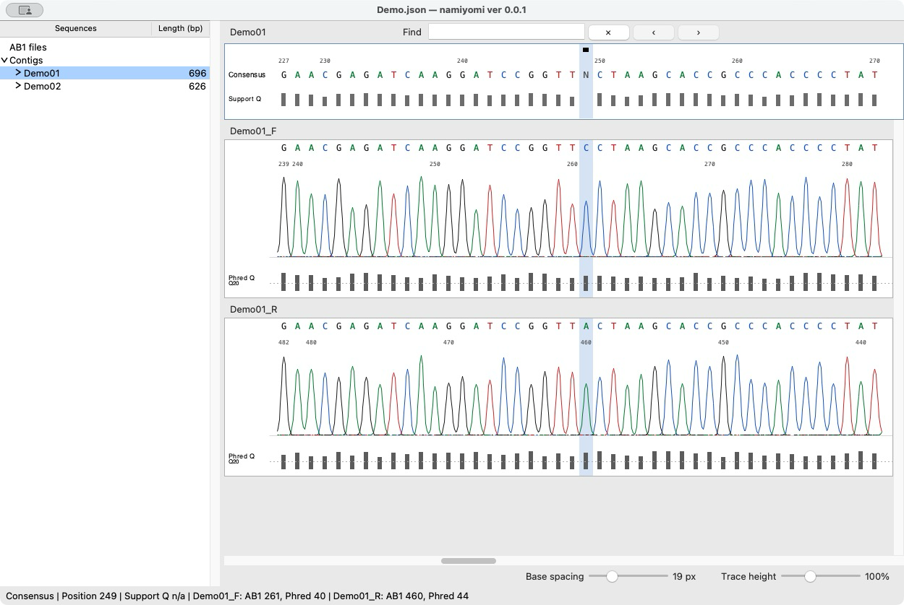
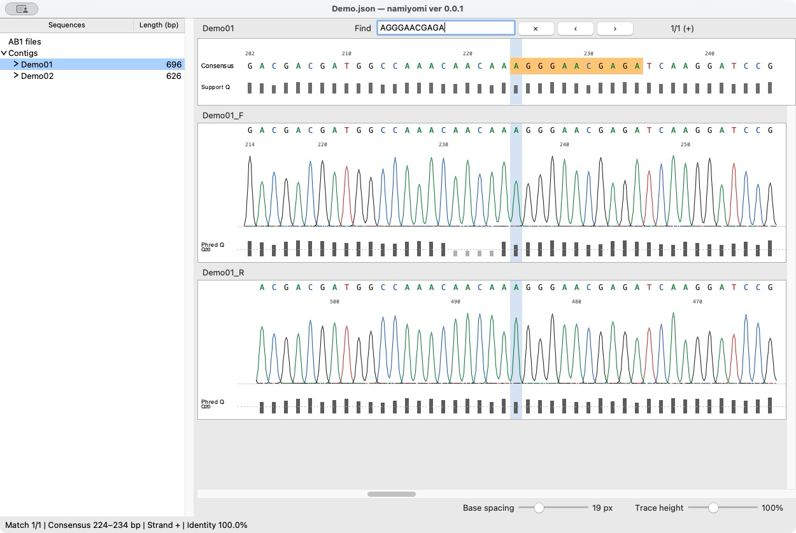

# namiyomi ver 0.0.1

**AB1の波形確認から、トリミング、コンティグ作成、配列編集、FASTA出力まで。**

namiyomiは、日常的なサンガーシーケンスの確認作業に用途を絞ったデスクトップアプリです。コンセンサス配列と、その根拠となるクロマトグラムを同じ画面で確認できます。配列データは端末内で処理され、外部には送信されません。アプリとソースコードはMITライセンスで無償公開しています。

[ダウンロード](https://github.com/yoneoka-katsuhiro/namiyomi/releases) · [English](README.md) · [ビルド・配布について](DISTRIBUTION.md)

*配列、波形、品質のバーを同じ座標で確認できます。確認が必要な位置にはレビューフラグが表示されます。画面は同梱の合成デモデータを使用しています。*

## ダウンロードと起動

| 配布ファイル | 対象 | 確認状況 |
| --- | --- | --- |
| `namiyomi-0.0.1-macOS-arm64-development.zip` | Apple Silicon、macOS 15以降 | 開発者のMacで動作を確認しています。アドホック署名の開発版で、Developer ID署名・Apple公証はありません。Intel版・Universal版ではありません。 |
| `namiyomi-0.0.1-Windows-x64.zip` | Windows 10/11、x64 | 試験公開です。実際のWindows PCによる、インポートから編集・保存・出力までの一連の操作確認は完了していません。エラーが出る可能性があります。 |

[Releases](https://github.com/yoneoka-katsuhiro/namiyomi/releases)から使用するOSのZIPをダウンロードしてください。Pythonと必要なライブラリは同梱しているため、別途インストールする必要はありません。

圧縮した配布ファイルは、実行環境と合成デモを含めて**macOS版が約41 MiB、Windows版が約26 MiB**です。これはダウンロード容量であり、メモリ使用量や処理速度の比較値ではありません。

**macOS：** ZIPを展開して`namiyomi`フォルダを開き、`namiyomi.app`を起動します。必要に応じてアプリをApplicationsフォルダへ移しても構いません。デモを試す場合は、別に入っている`demo`フォルダも残してください。未公証の開発版のため、Macで警告や起動制限が出る場合があります。Appleの公証を受けたアプリではありません。[Developer IDについてのApple公式説明](https://developer.apple.com/developer-id/)も確認し、実行するかどうかを判断してください。インストールのためにシステムのセキュリティ保護を無効にしないでください。

**Windows：** `namiyomi`フォルダ全体を展開し、`namiyomi.exe`を開きます。`_internal`フォルダは実行ファイルの隣に置き、実行ファイルだけを取り出さないでください。Authenticode署名はないため、Windowsでセキュリティ警告が出る場合があります。Windows用の自動ビルド・起動確認にはWindows Server 2022を使用します。各実行の結果は[Actions](https://github.com/yoneoka-katsuhiro/namiyomi/actions)で確認できますが、Windows 10/11実機での一連の操作確認に代わるものではありません。

ver 0.0.1は初期リリースです。元のAB1とプロジェクトをバックアップし、出力配列を確認してから解析に使用してください。

## できること

- ファイル名の規則に依存しないAB1の取り込み。
- 取り込み時の自動末端トリミングと、左右の手動カット。
- 選択した2本以上のリードからのコンティグ作成と、整列した波形の表示。
- 元リードの編集に応じたコンセンサスとSupport Qの再計算。
- レビューフラグ、塩基編集、逆相補、Undo/Redo、配列・FASTAのコピー。
- 両鎖に対応した配列検索。完全一致のほか、80～100%の一致率を設定可能。
- 編集可能なプロジェクトの保存、ローカルの復旧用スナップショット、FASTA出力。

クローニング設計、制限酵素地図、BLAST、系統解析、ゲノム規模のアセンブリは含めていません。AB1を開いてから、確認した配列を取り出すまでの作業に集中できます。アプリの利用にアカウントやクラウドサービスは必要ありません。

## デモを試す

両OSの配布ZIPには、人工的に生成した4本のAB1と、作成済みの`Demo.json`を含む`demo`フォルダを同梱しています。リポジトリの[`demo`](demo)にも同じファイルがあります。配列と波形はデモ用の合成データであり、**生物試料に由来する観測値や装置の実測データではありません。**

`demo`内のファイルを一緒に保ち、**File > Import Previous Project**から、展開した配布フォルダの`demo/Demo.json`を開いてください。コンティグの確認、Find検索、塩基編集とUndoを試せます。練習した内容は**Save Project As**で別ファイルへ保存できます。最初からコンティグを作る場合は、新規プロジェクトに4本のデモAB1を取り込んでください。

## 基本的な使い方

1. **AB1を取り込む。** **File > Import AB1**を選ぶか、ファイルをウィンドウへドラッグします。取り込んだリードは**AB1 files**に個別に並びます。この段階では、自動グループ化もコンティグ作成も行いません。末端の自動トリミングは初期設定で有効です。条件を変える場合は、取り込み前に**Settings > Trimming Settings**を開きます。
2. **波形とトリミング位置を確認する。** グレーの範囲は出力から除外されます。右下の**Base spacing**と**Trace height**で横幅と波形の高さを調整できます。追加のカットには**Edit > Cut Left / Cut Right**を使います。
3. **同一個体・同一領域のリードを選ぶ。** Shiftキーを押しながら必要なリードを選び、**Assembly > Build Contig (manual)**を実行します。3本以上にも対応しています。アセンブリは両方向を調べるため、ファイル名やプライマー名から向きを決める必要はありません。
4. **コンセンサスを確認・編集する。** フラグの位置を波形と照合します。塩基をクリックして入力すると置換でき、Backspaceで選択した塩基を削除できます。元リードの編集はコンセンサスへ反映されます。確認したフラグには**Review > Mark Reviewed**を使います。この操作は確認済みであることを記録するもので、品質値を上げるものではありません。
5. **保存・出力する。** **Save Project**は初回に保存名を尋ね、以後は同じファイルへ上書きします。**Export Project Copy**は、現在の保存先を変えずに別コピーを作ります。リードまたはコンティグを選んでFASTAを出力できます。右クリックの**Copy FASTA**は、選んだ配列をFASTA形式でクリップボードへコピーします。

コンティグを作り直す場合は、右クリックから**Return Reads to AB1**を選びます。元リードの編集とトリミングは残ります。削除するコンティグだけに加えた編集やレビューフラグは元リードへ転写されません。操作全体はUndoで戻せます。

### ファイル名を利用したAUTOアセンブリ

**Assembly > Build Contig (AUTO)**は、元のAB1ファイル名の最初の`_`より前を使って、未使用リードをグループ化します。たとえば`sample07_forward.ab1`と`sample07_reverse.ab1`は`sample07`としてまとめられ、成功したコンティグにはその名前が付きます。

AUTOは、各接頭辞が「同一個体の同一領域」を表す場合だけ使用してください。既存コンティグで使われているリードは対象から外れ、手動作成済みのコンティグも再構築しません。命名規則が異なるデータにはmanualを使います。1本だけのグループからもコンティグを作れますが、複数リードによる独立した裏付けにはなりません。

### 配列を検索する

*Findはコンセンサスの両鎖を検索します。一致箇所はオレンジ色で表示されます。画面の配列と波形はデモ用の合成データです。*

初期設定は完全一致です。**Settings > Find Settings**で、80～100%の一致率へ変更できます。類似検索は塩基の置換だけを対象とし、ギャップは考慮しません。IUPAC文字は文字どおりに照合し、ワイルドカードとしては扱いません。編集・挿入した塩基は検索に含まれ、削除した塩基は含まれません。矢印ボタンかEnter / Shift+Enterで一致箇所を移動でき、Escで検索を解除できます。検索によって配列が変わることはありません。

### よく使うショートカット

| 操作 | macOS | Windows |
| --- | --- | --- |
| プロジェクト保存 | ⌘S | Ctrl+S |
| Undo / Redo | ⌘Z / ⇧⌘Z | Ctrl+Z / Ctrl+Shift+Z |
| manualでコンティグ作成 | ⌘B | Ctrl+B |
| 配列コピー / FASTAコピー | ⌘C / ⇧⌘C | Ctrl+C / Ctrl+Shift+C |
| Find | ⌘F | Ctrl+F |
| 次 / 前のレビューフラグ | ⌘E / ⇧⌘E | Ctrl+E / Ctrl+Shift+E |

左の一覧を右クリックすると、よく使う操作を選べます。配列名のダブルクリックで名前を変更できます。**Sequences**または**Length (bp)**のダブルクリックでリードとコンティグを並べ替え、もう一度行うと順序が反転します。削除、AB1へ戻す操作、フラグ付き配列の出力の確認には**Don't ask again for this action**があります。**Settings > Confirmations**で、各確認を再び有効にできます。

## 他のソフトとの使い分け

サンガーデータを扱える無償・クロスプラットフォームのソフトは、namiyomi以外にもあります。違いは、主に作業の範囲と画面の構成です。[詳しい比較表](docs/COMPARISON-ja.md)では、ChromasPro、Geneious Primeのほか、GitHub上のSeqTrace、sangeranalyseR、Tracyも取り上げています。公式に確認できた機能と画面設計上の好みを分け、未測定の速度・精度の優位性は主張していません。

| ソフト | ライセンス・料金体系 | 開発元が案内するOS | 主な用途 |
| --- | --- | --- | --- |
| **namiyomi** | 無償、MITライセンス | macOS、Windows試験版 | AB1の確認、選択リードのコンティグ作成、コンセンサス編集、FASTA出力。 |
| [Chromas](https://technelysium.com.au/wp/chromas/) | アプリは無償。任意のPeakTraceサービスは別体系 | Windows | 単一の波形の表示・編集、トリミング、検索、配列出力。複数リードのアセンブリには、開発元がChromasProを案内しています。 |
| [ChromasPro](https://technelysium.com.au/wp/chromaspro/) | 有償、試用版あり | Windows | リードのアセンブリとグラフィカルなコンセンサス編集に加え、各種配列解析。 |
| [UGENE](https://ugene.net/) | 無償、オープンソース | Windows、macOS、Linux | 統合型のバイオインフォマティクス環境。Sanger editorと[CAP3連携](https://ugene.net/docs/extensions/cap3/)を含みます。 |

namiyomiは、少数のサンガーリードを波形で確認し、コンセンサスを取り出す用途を想定しています。より広い解析、別のファイル形式、既存の検証済みワークフローが必要な場合は、それに合うソフトを選んでください。他製品に対する速度・精度の優位性を主張する比較ではありません。比較表は2026年11月4日に各開発元の公式説明を確認して作成しました。

## 制約とデータの取り扱い

- **対象は小規模なサンガーコンティグです。** アセンブリはgreedy overlap方式です。初期条件は、比較可能な塩基が100以上の重複と90%以上の一致率です。反復配列の解決やゲノムアセンブリには適していません。ファイル名や配列の重なりだけで、個体・領域・コンタミネーションの有無は判定できません。
- **Support Qは、統計的に統合された確率ではありません。** 自動コールを支持する、使用可能な元のPhredの最大値です。高品質な塩基の不一致や内部ギャップは`N`とフラグで残る場合があります。手動編集した塩基に装置由来の品質値は付きません。
- **向きの統一は相対的なものです。** 類似する既存コンティグのうち、先に作ったものを基準に向きを揃えます。遺伝子の生物学的な正方向を判定する機能ではありません。
- **プロジェクトJSONだけでは波形を持ち運べません。** JSONはAB1のパスとチェックサムを保存し、波形自体は埋め込みません。元のAB1は変更しません。別のPCへ移すときは、参照先のAB1と相対的なフォルダ構成も一緒に保ってください。AB1が見つからない、または内容が変わった場合は、プロジェクトを開けないことがあります。
- **復旧用スナップショットはバックアップの代わりではありません。** 未保存の変更は約30秒ごとに端末内へ記録しますが、異常終了の直前の編集やUndo履歴は失われる可能性があります。通常の保存とバックアップを併用してください。

## ライセンス・引用・不具合報告

アプリ本体とソースコードには[MITライセンス](LICENSE.txt)を適用します。同梱ライブラリには、それぞれのライセンスと通知が適用されます。

引用例：

> Yoneoka, K. (2026). *Namiyomi: Sanger chromatogram review and contig assembly* (Version 0.0.1) [Computer software]. GitHub. https://github.com/yoneoka-katsuhiro/namiyomi

本文中では **Yoneoka (2026)**、括弧内では **(Yoneoka, 2026)** と表記します。

[CITATION.cff](CITATION.cff)にも引用情報を記載しています。解析方法を記す際は、バージョン、処理条件、手動確認の判断も記録してください。DOIは未取得です。

不具合は[GitHub Issues](https://github.com/yoneoka-katsuhiro/namiyomi/issues)へお願いします。OS、アプリのバージョン、再現手順、エラー文またはスクリーンショットがあると確認しやすくなります。非公開・未発表の配列データは、公開してよいと判断した場合だけ添付してください。

開発：Katsuhiro Yoneoka — Mishima, Shizuoka, Japan
