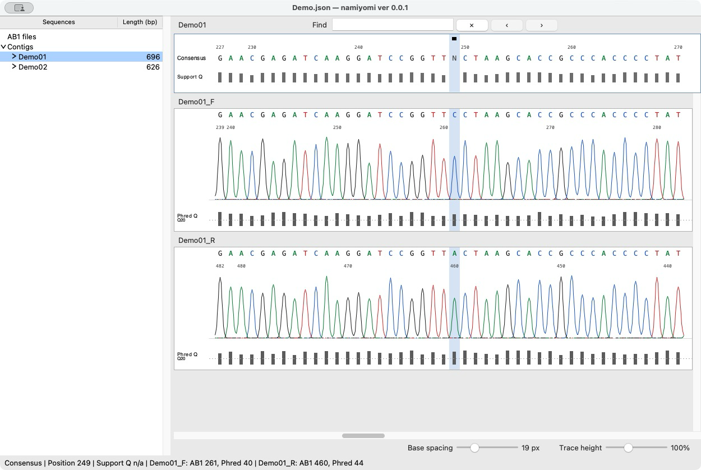
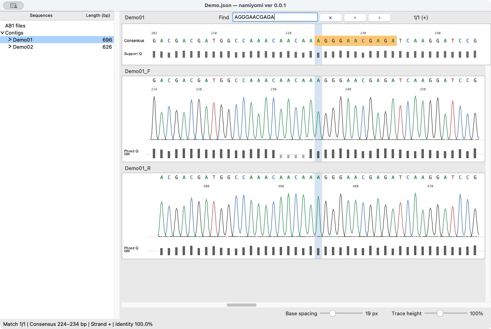

# namiyomi ver 0.1.0

A focused desktop editor for Sanger sequencing: inspect AB1 chromatograms, trim read ends, assemble selected reads, review the consensus, and export FASTA.

namiyomi keeps the sequence and its supporting traces in one workspace. It is designed for routine, small-scale Sanger work rather than as an integrated bioinformatics suite. Its features are **deliberately limited to what this work needs**, so there is little to configure or learn before you start. All sequence processing takes place locally. The application and source code are free under the MIT License.

## Download namiyomi here

- **[Download for macOS — Apple Silicon, macOS 15+](https://github.com/yoneoka-katsuhiro/namiyomi/releases/download/v0.1.0/namiyomi-0.1.0-macOS-arm64-development.zip)**
- **[Download for Windows — Windows 10/11 x64, experimental](https://github.com/yoneoka-katsuhiro/namiyomi/releases/download/v0.1.0/namiyomi-0.1.0-Windows-x64.zip)**

These ZIPs contain the ready-to-run application. No Python installation is required. The files in the repository are for developers; you do not need to download them to use namiyomi.

[Release notes](https://github.com/yoneoka-katsuhiro/namiyomi/releases/tag/v0.1.0) · [日本語](README-ja.md) · [Build and distribution guide](DISTRIBUTION.md)



*Review the consensus alongside its supporting chromatograms. Base calls, quality bars, and review flags share the same sequence coordinates. This screenshot uses the synthetic demonstration data supplied with the project.*

## Download and open

| Package | System | Release status |
| --- | --- | --- |
| `namiyomi-0.1.0-macOS-arm64-development.zip` | Apple Silicon, macOS 15 or later | Tested on the developer's Mac. Ad-hoc signed; not Developer ID signed or Apple notarized. Not an Intel or universal build. |
| `namiyomi-0.1.0-Windows-x64.zip` | Windows 10/11, x64 | Experimental. Full hands-on testing on a physical Windows PC has not been completed. Errors may occur. |

Download the appropriate ZIP from [Releases](https://github.com/yoneoka-katsuhiro/namiyomi/releases). Standalone packages include Python and their dependencies; a separate Python installation is not required.

The compressed downloads are approximately **41 MiB for macOS** and **26 MiB for Windows**, including the runtime and synthetic demo. These are package sizes, not memory-use or performance benchmarks.

**macOS:** extract the ZIP, open its `namiyomi` folder, then open `namiyomi.app`. You can move the application to an Applications folder if desired; keep the separate `demo` folder if you want to try the example project. This is an unnotarized development release. macOS may warn about or block the application; the package has not received Apple's notarization. See [Apple's explanation of Developer ID](https://developer.apple.com/developer-id/) before deciding whether to run it. Do not disable system security protections to install namiyomi.

**Windows:** extract the complete `namiyomi` folder, then open `namiyomi.exe`. Keep the `_internal` folder beside the executable; do not copy the executable out on its own. The executable is not Authenticode signed, so Windows may display a security warning. The Windows build workflow uses Windows Server 2022 for automated build and startup checks; consult [Actions](https://github.com/yoneoka-katsuhiro/namiyomi/actions) for the outcome of each run. Those checks do not replace hands-on testing of the complete workflow on Windows 10/11.

Version 0.1.0 is an early release. Back up your AB1 files and projects, and check exported sequences before using them in an analysis.

## What namiyomi does

- Imports AB1 files without assuming a particular filename pattern.
- Automatically trims low-quality ends on import, with adjustable settings and manual left/right cuts.
- Builds a contig from two or more selected reads and displays their aligned chromatograms beneath the consensus.
- Recalculates the linked consensus and its supporting-quality display when a source read is edited.
- Provides review flags, base editing, reverse complement, Undo/Redo, and sequence/FASTA copying.
- Finds consensus subsequences on either strand, with exact matching by default and an adjustable 80–100% identity threshold.
- Saves editable projects, writes local recovery snapshots, and exports FASTA without modifying the original AB1 files.

The interface deliberately omits cloning design, restriction mapping, BLAST, phylogenetics, and genome-scale assembly. Its scope is the work between opening Sanger reads and obtaining a reviewed sequence. No account or cloud service is needed to use the application, and sequence data are not uploaded.

## Try the demonstration

Both application ZIPs include a `demo` folder with four synthetic AB1 files and a prepared `Demo.json` project. The same files are available in the repository's [`demo`](demo) directory. The sequences and trace signals were generated for demonstration; they are **not biological observations or instrument measurements**.

Keep the files in `demo` together, then choose **File > Import Previous Project** and open `demo/Demo.json` from the extracted application folder. You can inspect the prepared contigs, try Find, edit a base, and Undo the change. Use **Save Project As** to save your practice session separately. To practise assembly from scratch, start a new project and import the four demonstration AB1 files instead.

## A typical session

1. **Import the reads.** Choose **File > Import AB1** or drag AB1 files into the window. Reads remain separate in **AB1 files**; importing does not group them or build contigs. Automatic end trimming is enabled by default. Adjust **Settings > Trimming Settings** before importing if needed.
2. **Inspect the chromatograms.** Check trimmed ends and ambiguous calls. Gray regions are excluded from the retained sequence. Adjust **Base spacing** and **Trace height** at the bottom right. Use **Edit > Cut Left / Cut Right** for additional cuts.
3. **Select reads from one specimen and one locus.** Shift-click the relevant entries, then choose **Assembly > Build Contig (manual)**. Three or more reads are supported. The assembler checks both orientations; names and primer labels do not determine the alignment.
4. **Review the consensus.** Examine flagged positions against the traces. Click a base to edit it; Backspace removes selected calls. Source-read edits recalculate the linked consensus. Use **Review > Mark Reviewed** after checking a flagged call. A review acknowledgement does not improve its quality score.
5. **Save and export.** **Save Project** first asks for a filename, then updates that same file. **Export Project Copy** leaves the current save destination unchanged. Select a read or contig and choose **Export FASTA**, or use **Copy FASTA** from its right-click menu.

If an assembly needs to be redone, right-click its contig and choose **Return Reads to AB1**. The reads keep their edits and trimming. The removed contig's consensus-only edits and review flags are not transferred to them; Undo restores the whole operation.

### Optional filename-based assembly

**Assembly > Build Contig (AUTO)** groups unused reads by the part of the original filename before its first underscore. For example, `sample07_forward.ab1` and `sample07_reverse.ab1` form the group `sample07`. A successful group receives that name as its contig identifier.

Use AUTO only when each prefix identifies one specimen **and one locus**. Reads already used by an existing manual or AUTO contig are excluded, and existing contigs are not rebuilt. Use the manual command when filenames do not follow this convention. A single-read group can form a contig, but it does not provide independent multi-read confirmation.

### Find a sequence on either strand



*Enter a DNA sequence in Find to highlight matching consensus sites. The search also checks the reverse complement. These demonstration traces are synthetic.*

The default is 100% identity. **Settings > Find Settings** permits 80–100% identity for substitution-only, ungapped matching. IUPAC letters match literally, not as wildcard sets. Search includes edited consensus calls and insertions, excludes deleted calls, and never changes the sequence. Use the arrow buttons or Enter / Shift+Enter to move between matches; Esc clears the query.

### Useful shortcuts

| Action | macOS | Windows |
| --- | --- | --- |
| Save project | ⌘S | Ctrl+S |
| Undo / Redo | ⌘Z / ⇧⌘Z | Ctrl+Z / Ctrl+Shift+Z |
| Build Contig (manual) | ⌘B | Ctrl+B |
| Copy sequence / Copy FASTA | ⌘C / ⇧⌘C | Ctrl+C / Ctrl+Shift+C |
| Find | ⌘F | Ctrl+F |
| Next / previous review flag | ⌘E / ⇧⌘E | Ctrl+E / Ctrl+Shift+E |

Right-click the sidebar for common actions. Double-click a sequence name to rename it. Double-click **Sequences** or **Length (bp)** to sort reads and contigs, then repeat to reverse the order. Delete, return-to-AB1, and export-with-flags confirmations offer **Don't ask again for this action**; **Settings > Confirmations** restores each prompt independently.

## Command-line batch processing

namiyomi can also build contigs for a whole folder of AB1 files without opening the window. The batch tool uses namiyomi's own trimming, assembly and consensus code, and writes the results to a folder you choose; **your AB1 files are never modified**. It is available **from the source code only** (it is not in the application ZIPs) and needs Python 3.10 or later. Full details: [docs/BATCH.md](docs/BATCH.md).

### Set up (once)

Check your Python version with `python3 --version` (Windows: `py --version`). The `python3` that comes with macOS is 3.9, which is too old; install a newer one from [python.org](https://www.python.org/downloads/) or Homebrew. Then, in a terminal, from the namiyomi folder (the one with this README):

```
python3 -m venv .venv                                # Windows: py -m venv .venv
.venv/bin/pip install -r requirements/batch.txt      # Windows: .venv\Scripts\pip install -r requirements\batch.txt
```

### Run

Make a folder for the project with the AB1 files in a subfolder, for example `~/projects/rbcL-2026/reads`. Then, from the namiyomi folder:

```
.venv/bin/python src/batch.py --input ~/projects/rbcL-2026/reads --output ~/projects/rbcL-2026/results
```

On Windows, use `.venv\Scripts\python src\batch.py` and Windows paths.

Add `--dry-run` to preview the groups without writing anything.

- **Grouping.** By default, files are grouped by the text before the first underscore, as in **Build Contig (AUTO)**. If one folder holds several loci, give a CSV sample sheet with the columns `file,sample,marker` (`--sheet sheet.csv`).
- **Sorting.** Each contig is sorted into **clean**, **needs review** (flagged positions), **single read** (only one usable read, including pairs where one read was trimmed to nothing) and **failed**. One failing group never stops the others.

| File | Contents |
| --- | --- |
| `project.json` | All contigs, unedited. Open it in the window to check the flagged positions (see below). |
| `summary.tsv`, `summary.json` | One row per contig with its category, reads and flagged columns. |
| `*.fasta` | One file per marker (`auto.fasta` with the default grouping). Single-read sequences are exported only with `--allow-single`. |

To open a project, use **File > Import Previous Project** in the namiyomi application. If you only have the source code, install the window's extra dependency once (`.venv/bin/pip install -r requirements/runtime.txt`; Windows: `.venv\Scripts\pip`) and run `.venv/bin/python src/app.py --project ~/projects/rbcL-2026/results/project.json`. Keep the AB1 files where they are: projects refer to them by relative path (see the limits below).

## AI-assisted review

namiyomi can also work with an AI assistant such as Claude, through an [MCP](https://modelcontextprotocol.io/) server. The assistant builds the contigs with the batch tool, inspects the flagged positions and, if you ask, reviews them and trims the ends, whether you have one pair of reads or several hundred. You check the result in the window as usual.

### Set up (once)

Set up the batch tool first (above). Then register the server with Claude Code, from the namiyomi folder:

```
claude mcp add -s user namiyomi -- "$(pwd)/.venv/bin/python" "$(pwd)/src/mcp_server.py"
```

On Windows (PowerShell): `claude mcp add -s user namiyomi -- "$PWD\.venv\Scripts\python.exe" "$PWD\src\mcp_server.py"`.

`-s user` makes the tools available in every folder, not only in the namiyomi folder, so you can start the assistant wherever your data are. For Claude Desktop, add the same command to its configuration file instead; [docs/BATCH.md](docs/BATCH.md) gives the file locations for macOS and Windows.

Then check and restart:

1. `claude mcp list` should show `namiyomi: … ✔ Connected`.
2. Restart the assistant, because the tools are loaded only when a session starts. Claude Code in a terminal: quit and run `claude` again. Claude Code in VS Code: start a new conversation, or run **Developer: Reload Window**. Claude Desktop: quit the app fully and reopen it.

### Working with the assistant

Put the AB1 files in a project folder as above, start the assistant in the project folder (for Claude Code: `cd ~/projects/rbcL-2026`, then `claude`) and ask in plain language, for example:

> Build contigs from the reads in `reads`, write the results to `results`, and review the flagged positions yourself.

The assistant then:

1. **Scans** the folder and proposes groups, as the batch tool does. To use a sample sheet, say so.
2. **Builds** and sorts the contigs, as the batch tool does.
3. **Reviews** each flagged position. It reads the per-read calls and Phred scores and looks at a rendered chromatogram of the position. It changes a call only when one base clearly dominates the signal, and leaves anything unclear as `N`.
4. **Reports** what it did, with the changes and reasons for each, and the positions it left unresolved.

Without the review request (or by asking for "human review"), the assistant stops after sorting the results and hands you `project.json` to check in the window.

In practice, most flags are usually not conflicts between reads but low-quality bases at the end of one read, beyond where the other read reaches (these contigs are noticeably longer than the clean ones). Those positions are read from one trace only, so the assistant often has to leave them as `N`. How much of such an end to keep is a judgement call. Trimming strictly to the region covered by both reads is simple but can discard many usable bases, so you may prefer to trim the single-read end by quality and accept an occasional `N` to keep a longer sequence. You can trim in the window, or ask the assistant for help:

- "Compare trimming options for the contig ends in `results`" gives a per-contig table of the single-read ends (length, quality, `N`s) and what common rules would keep: quality-based (a rolling mean of Phred scores), cutting before a run of `N`s, or keeping only the region both reads cover.
- "Trim each single-read end before the first run of 4 or more `N`s" (or a rolling-mean rule) shows the proposed cuts and applies them after you confirm.

In Claude Code, `/mcp__namiyomi__trim_contig_ends` starts this guided workflow. The assistant does not trim unless you ask.

The assistant writes the same files as the batch tool, plus these when it edits; `project.json` and the batch FASTA files stay unedited:

| File | Contents |
| --- | --- |
| `project.reviewed.json` | A copy with the assistant's edits and trims. Open it the same way as `project.json`; positions it left unresolved are still marked as review flags. |
| `review_report.md` | Every edit with its reason, to check or undo, followed by the list of positions left unresolved. |
| `*.reviewed.fasta` | FASTA with the assistant's edits (for example `auto.reviewed.fasta`), written when it exports the reviewed project. |

You can also ask the assistant to open a project in the window for you.

### What to keep in mind

- **The AI's review is a second opinion, not ground truth.** It sees the same traces and quality scores you do, but may misjudge noisy or overlapping peaks. As elsewhere in this README, check the sequences before using them in analysis. Start with the positions it left unresolved and the edits in low-quality stretches. Each edit is logged so it can be reversed, and `project.json` is always kept unedited.
- **Your data is shared with the assistant.** namiyomi's tools make no network connections, but in this mode the sequences, quality scores and chromatogram images it requests become part of your conversation with the AI service. Do not use it with data that you may not share with that service.

## Choosing a tool

namiyomi does one job: review AB1 chromatograms, build contigs, correct the consensus while looking at the traces, and export FASTA. The alternatives fall into four groups. The table shows what namiyomi and each group can and cannot do.

| Software | Operating systems | What it can do | What it cannot do |
| --- | --- | --- | --- |
| **namiyomi** | macOS (Apple Silicon, 15 or later)<br>Windows 10/11 (x64, experimental) | Sanger assembly and editing. Contigs built manually or automatically. A minimal, intuitive design that is easy to understand, optimized for research and teaching use. | Complex operations such as NGS read assembly and reference mapping are out of scope. |
| **Commercial Sanger suites** | **Sequencher:** Windows (the current version does not support 64-bit macOS)<br>**Geneious Prime:** Windows, macOS, Linux<br>**ChromasPro:** Windows only | Sanger assembly and editing, plus broader analyses (depending on the product: heterozygote and mutation detection, reference mapping, cloning tools, NGS), batch assembly with configurable naming rules (in several products), and vendor support. | They cannot be used free of charge for regular research work; a purchased or subscription license is required. You also have to find the steps you need among many general-purpose tools. |
| **Free chromatogram viewers** | **Chromas:** Windows only | Viewing, editing, trimming, searching, and exporting a single chromatogram. | It cannot assemble reads into a contig; its developer directs users to the commercial ChromasPro for that. |
| **Free bioinformatics toolkits** | **UGENE:** Windows, macOS, Linux | Many analysis tools in one program, including a Sanger reads editor and CAP3 assembly. | It is not dedicated to Sanger review; you choose the steps you need from a large set of general-purpose tools. |
| **R and command-line tools** | **sangeranalyseR:** R on Windows, macOS, Linux<br>**Tracy:** macOS, Linux (Bioconda, Homebrew, containers) | Scripted, reproducible batch processing and reports. | They cannot be used without R or the command line, and you cannot correct individual bases while looking at the traces (sangeranalyseR's documentation directs manual editing to another tool). |

Choose one of the other tools when you need what it adds. namiyomi has not been benchmarked against them for speed or accuracy. The [detailed comparison](docs/COMPARISON.md) lists each application's documented features, platforms, and licensing, with links to the developers' documentation.

## Important limits and data handling

- **Assembly requires related, overlapping reads.** The greedy overlap assembler is for small Sanger contigs, not genome assembly or repeat resolution. Defaults are a minimum overlap of 100 comparable bases and 90% identity. A filename or overlap cannot establish specimen identity, locus identity, or absence of contamination.
- **Review flags identify positions to inspect.** Conflicting high-quality calls and internal alignment gaps can remain `N`. **Support Q** is the highest usable original Phred score supporting an automatic call, not a calibrated combined confidence probability. Manually edited source calls do not acquire instrument Phred scores.
- **Relative orientation is not biological annotation.** Orientation unification uses earlier sufficiently similar contigs as references. The first contig in each matching locus sets the relative direction; namiyomi does not determine a gene's biological forward strand.
- **A project is not a self-contained AB1 archive.** Project JSON stores source-file paths and checksums, not the chromatograms themselves. Keep the original AB1 files available. When moving a project, include the referenced AB1 files and preserve their relative folder structure. Changed or missing sources can prevent reopening.
- **Recovery is a safeguard, not a backup.** Unsaved edits receive local recovery snapshots approximately every 30 seconds. A crash can still lose the most recent edits and Undo history. Save regularly and keep independent backups.

## License, citation, and feedback

namiyomi is released under the [MIT License](LICENSE.txt). Bundled dependencies retain their own licenses and are accompanied by third-party notices.

Suggested citation:

> Yoneoka, K. (2026). *Namiyomi: Sanger chromatogram review and contig assembly* (Version 0.1.0) [Computer software]. GitHub. https://github.com/yoneoka-katsuhiro/namiyomi

In text, cite **Yoneoka (2026)** or **(Yoneoka, 2026)**.

Machine-readable metadata is available in [CITATION.cff](CITATION.cff). Record the software version, processing settings, and manual review decisions when describing your workflow. No DOI has been assigned.

Report a problem through [GitHub Issues](https://github.com/yoneoka-katsuhiro/namiyomi/issues). Include the operating system, namiyomi version, steps to reproduce, and the error message or a screenshot. Do not upload confidential or unpublished sequence data unless you intend to make it public.

Developed by Katsuhiro Yoneoka, Mishima, Shizuoka, Japan.
